<p align="right"><b>English</b> | <a href="README.zh-CN.md">简体中文</a></p>

# AutoMimic — a self-improving harness that teaches a humanoid acrobatics from one internet video

<p align="center">
  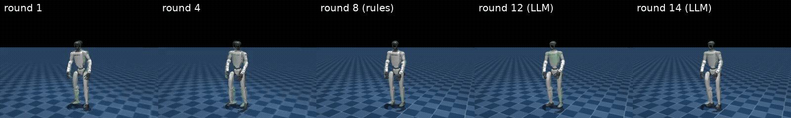
  <br/><sub><b>Same video, same robot, different rounds.</b> Unitree G1 (real G1 EDU torque limits, knee 120 N·m) learning a
  standing backflip from a single monocular internet clip. Round 1 → 14 of the harness; white = robot, green = reference.</sub>
</p>

### From one internet video to the robot

| backflip | 闪身步 (dance) | 狗熊哆嗦毛 (dance) |
|---|---|---|
| 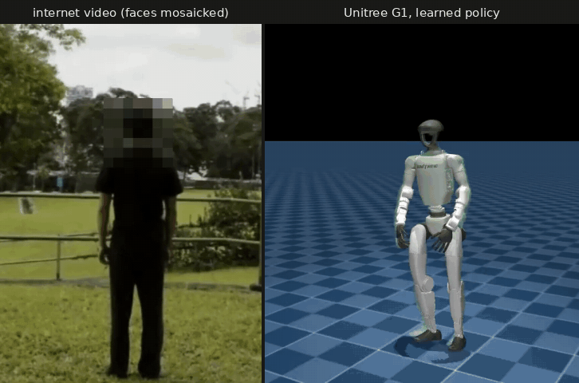 | 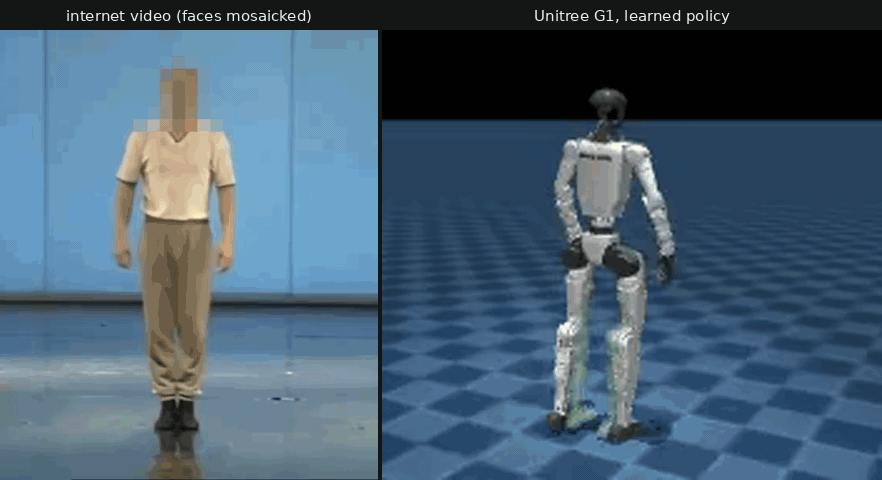 | 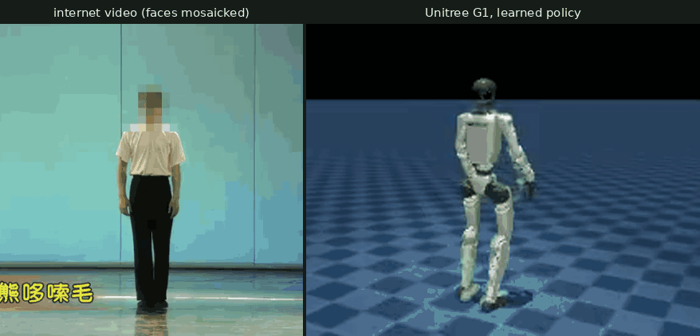 |

<p align="center">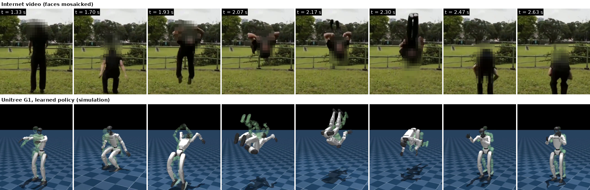<br/>
<sub>Left / top: the monocular internet clip the skill was learned from (faces mosaicked, third-party footage used for
research); right / bottom: the learned Unitree G1 policy in simulation.</sub></p>

**AutoMimic** turns a single in-the-wild human video into a robust humanoid skill. A *harness* wraps the whole
video-to-policy pipeline in a loop: **programs measure, a foundation model decides, rules guard**. Every round it
trains a tracking policy, evaluates the full rollout frame by frame, measures what went wrong from many angles, and
an LLM decider ranks the failures and repairs them — by tuning a reward template, by **writing new reward /
termination code**, or by **repairing the reference motion with physics**. Every failure it meets becomes an entry of
a growing, three-level **diagnostic library** (generic → motion family → task) that the next skill starts from.
Everything runs on **one laptop GPU** (RTX 5060 Laptop, 8 GB; ~70 min per round).

<p align="center">
  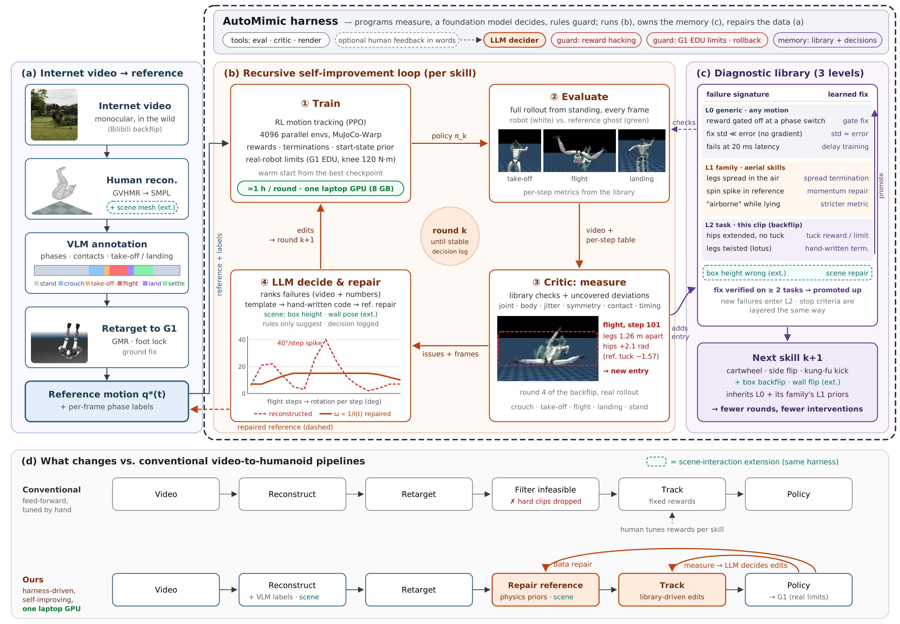
  <br/><sub>Overview (paper Fig. 1). (a) video → reconstruction → VLM phase labels → retarget; (b) the per-skill loop
  train → evaluate → critic → LLM decide & repair; (c) the three-level diagnostic library (generic → motion family
  → task; verified fixes are promoted up, stop criteria are layered the same way) that the next skill inherits;
  (d) the difference to feed-forward pipelines.</sub>
</p>

---

## Results so far

### Backflip — from walking off after landing to a clean, quiet flip (LLM-mode rounds)

| round | decided by | rotation | plane dev. | after-landing action change ↓ | pelvis speed after landing ↓ | body tracking error ↓ | what the decider found / fixed |
|---|---|---|---|---|---|---|---|
| 8 | rules | 344° | 18.5° | 0.30 | – | – | (rules baseline, last round) |
| 9 | LLM | 358° | 17.0° | 0.41 | 1.20 m/s | 0.120 m | template fixes had std ≪ error → no gradient; hip tuck 9 steps late |
| 10 | LLM | 353° | 9.1° | 0.14 | 0.44 m/s | 0.104 m | rules had silently tightened the tracking curriculum (found by diffing training logs) |
| 11 | LLM | 371° | 5.3° | 0.37 | 1.04 m/s | 0.106 m | best-score checkpoint ≠ best policy → decider picks the start |
| 12 | LLM | 368° | 9.1° | **0.05** | **0.14 m/s** | 0.083 m | **root cause**: balance rewards were gated off at the settle→stand label switch |
| 13 | LLM | 367° | 9.3° | 0.04 | 0.05 m/s | 0.073 m | fidelity curriculum step |
| 14 | LLM | 365° | 6.4° | 0.05 | 0.08 m/s | **0.064 m** | curriculum converged → robustness |

All numbers are measured on the full rollout from standing (`rl/flip_auto/analysis/rNN_quant.md`); every decision,
with its expectations and rollback condition, is logged in [`rl/flip_auto/decisions/`](rl/flip_auto/decisions/).

### Robustness and sim-to-sim (round 14 policy)

| scenario | mjlab, 256 envs | native MuJoCo (CPU), 100 runs |
|---|---|---|
| nominal | 100 % | 100 % |
| training randomisation (pushes, friction 0.3–1.2, CoM, encoder bias, obs. noise) | 100 % | – |
| foot friction 0.5 / 1.0 | – | 100 % / 100 % |
| PD stiffness × 0.85 | 100 % | 100 % |
| control latency 20 ms | 70 % | 90 % |
| control latency 40 ms | 0 % | 0 % |

The native MuJoCo port re-implements observation, action and actor without mjlab code and matches mjlab to 1e-5;
the closed-loop gap was traced to how MuJoCo C vs. MuJoCo-Warp integrate damping of torque-saturated actuators
([`sim2sim/results_flip.md`](sim2sim/results_flip.md)). Round 15 trains with randomised control latency.

---

## Gallery

| | |
|---|---|
| 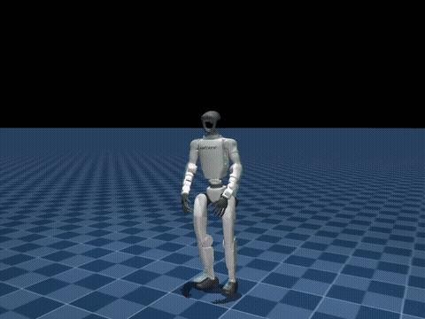<br/><sub>Backflip, round 14 (mjlab, HD eval)</sub> | 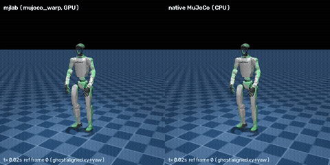<br/><sub>Sim-to-sim: mjlab (left) vs. native MuJoCo CPU (right)</sub> |
| 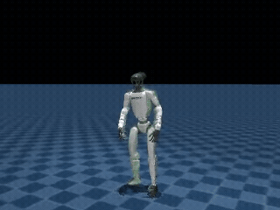<br/><sub>Round 1: first full rotation, no landing</sub> | 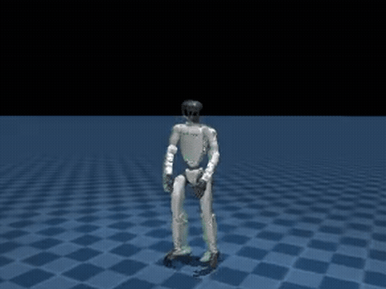<br/><sub>Round 4: first upright landing</sub> |
| 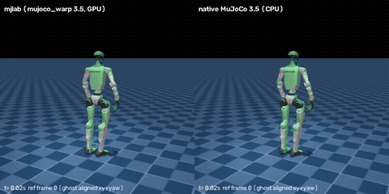<br/><sub>Dance specialist (闪身步) in both simulators</sub> | 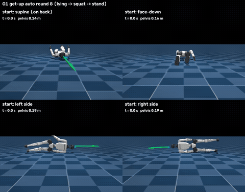<br/><sub>Get-up from four lying poses (harness-tuned rewards)</sub> |

Full-resolution clips are next to the GIFs in [`docs/media/`](docs/media/).

---

## How a round works (LLM-in-the-loop protocol)

```
train (1500 PPO iters, 4096 envs)
  → evaluate: HD full rollout, per-step table, every-frame sheets, robustness (256 envs × 5 scenarios)
  → step 1  quant_report.py   metrics vs. last round, per-phase deviations, signal of every active fix,
                               training-config audit (log diff), per-segment drift, robustness
  → step 2  LLM analysis       causes + priorities after reviewing ALL frame sheets   (analysis/rNN_llm.md)
  → step 3  decision           knobs, library fixes + their std, hand-written code, start checkpoint,
                               expectations, rollback condition                         (decisions/rNN.json)
  → next round (the harness refuses a decision without steps 1–2 and all sheets reviewed)
```

Rule-based adjustments still run, but only as *suggestions* in the report — `--mode rules` is kept as the ablation
(rounds 1–8 are frozen in `rl/flip_auto/runs/rules_v1_r01-r08/`).

## Repository map

| path | what |
|---|---|
| [`scripts/data/`](scripts/data/) | video search / download, GVHMR reconstruction, VLM phase labels, GMR retarget, reference repair (ballistic flight, angular-momentum-consistent rotation, rotation-lag retiming) |
| [`rl/train_dance.py`](rl/train_dance.py) | BeyondMimic-style tracking training on mjlab / MuJoCo-Warp (phase-weighted start states, real torque limits, latency) |
| [`rl/mimic_generic.py`](rl/mimic_generic.py) | generic (L0) reward templates and real-robot constraints |
| [`rl/flip_rewards.py`](rl/flip_rewards.py) | aerial-family (L1) and backflip-specific (L2) technique rewards and terminations |
| [`rl/flip_auto/`](rl/flip_auto/) | **the harness**: `harness.py`, `critic.py`, `quant_report.py`, `library.py` (diagnostic library), decisions, analyses |
| [`rl/eval_flip.py`](rl/eval_flip.py), [`rl/eval_flip_robust.py`](rl/eval_flip_robust.py) | full-rollout evaluation and 256-env robustness evaluation |
| [`sim2sim/`](sim2sim/) | native MuJoCo (CPU) re-implementation, exported models (`models/*.mjb`), equivalence and closed-loop reports |
| [`policies/`](policies/) | trained policies with their reference motion, labels and eval videos (backflip r04/r12/r13/r14, get-up, two dances) |
| [`live/`](live/), [`vla/`](vla/), [`artifacts/vla/`](artifacts/vla/) | live follow-dance demo: skeleton-based action recognition (models + keypoint data) → policy replay |
| [`paper/`](paper/) | figures (v1–v8, every version kept), captions, related-work and MimicX comparison |

## Quick start

```bash
# environments (WSL2 / Ubuntu 22.04): see scripts/setup/ — unitree_rl_mjlab (mjlab + MuJoCo-Warp), gvhmr, gmr
# replay a trained backflip and evaluate it
python rl/eval_flip.py --ckpt policies/backflip_r14_fid2/policy.pt \
  --motion policies/backflip_r14_fid2/reference_motion.npz --labels policies/backflip_r14_fid2/labels_50fps.npz \
  --knee-limit 120 --size 960 720
# robustness (256 envs per scenario)
python rl/eval_flip_robust.py --ckpt policies/backflip_r14_fid2/policy.pt \
  --motion policies/backflip_r14_fid2/reference_motion.npz --knee-limit 120
# one harness round in LLM mode (needs decisions/rNN.json for that round)
bash rl/flip_auto/launch_llm.sh <round>
```

## Data notice

Source videos are third-party internet videos used for research. Only the clips actually used are kept, with faces
mosaicked; full raw videos, SMPL/SMPL-X body models and AIST++ are **not** included (download them from their
original sources under their licenses). The pose model `yolov8n-pose.pt` comes from Ultralytics.

## Status

Research in progress (backflip: development skill; next: side flip and cartwheel with a frozen harness, MimicX-rules
baseline, multi-seed evaluation, sim-to-sim for every skill). Code under the Apache-2.0 license (see LICENSE); third-party footage keeps its original copyright.
