<p align="right"><a href="README.md">English</a> | <b>简体中文</b></p>

# AutoMimic —— 一个会自我改进的 harness，从一段网络视频教人形机器人做高难度动作

<p align="center">
  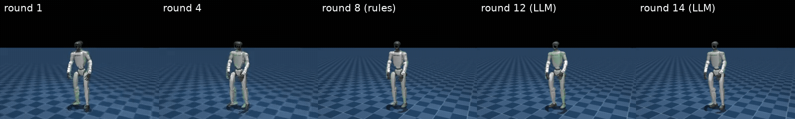
  <br/><sub><b>同一段视频、同一个机器人、不同的迭代轮次。</b>Unitree G1（真机 G1 EDU 扭矩限制，膝关节 120 N·m）从一段单目网络视频学习原地后空翻。
  harness 第 1 轮 → 第 14 轮；白色为机器人，绿色为参考动作。</sub>
</p>

### 从一段网络视频到机器人

| 后空翻 | 侧手翻 |
|---|---|
| 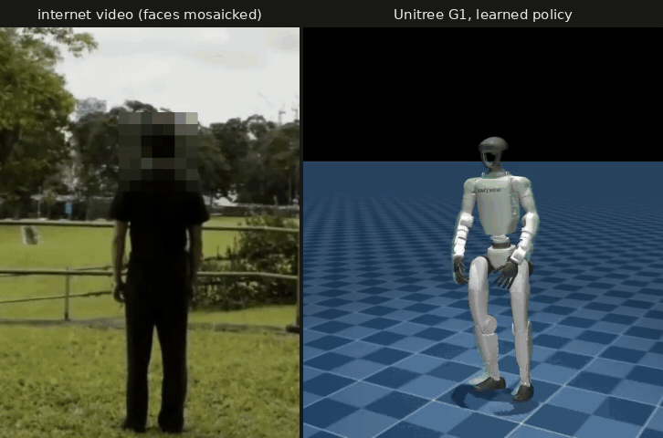 | 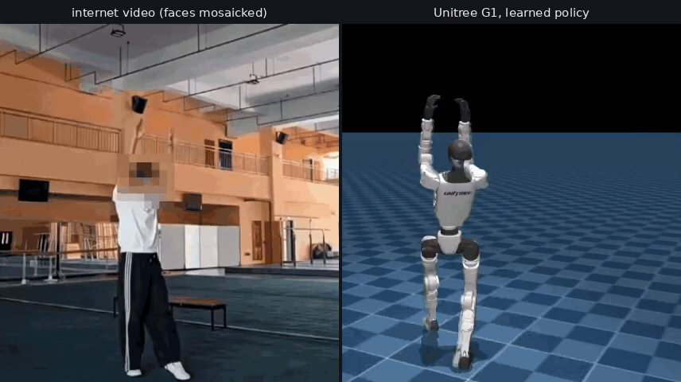 |

| 闪身步（舞蹈） | 狗熊哆嗦毛（舞蹈） |
|---|---|
| 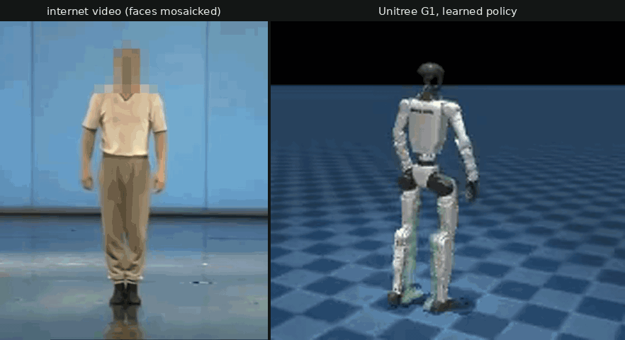 | 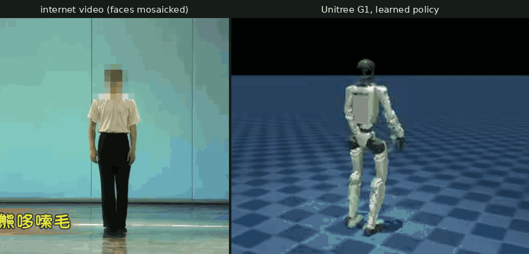 |

<p align="center">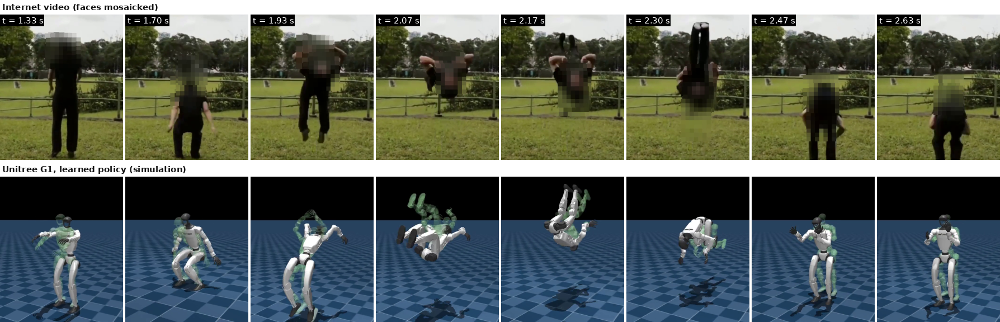<br/>
<sub>左 / 上：学习所用的单目网络视频片段（人脸已打码，第三方视频，仅用于研究）；右 / 下：在仿真中学到的 Unitree G1 策略。</sub></p>

**AutoMimic** 把一段野外拍摄的人类视频变成鲁棒的人形机器人技能。整个"视频 → 策略"的流程被包在一个 *harness* 循环里：
**程序负责测量，大模型负责决策，规则负责兜底**。每一轮它会训练一个跟踪策略，逐帧评测完整的动作，从多个角度量化问题；
然后由大模型 decider 判断问题的轻重缓急并修复：调整 reward 模板、**编写新的 reward / termination 代码**，或者**用物理规律修复参考动作**。
遇到的每一种失败都会成为不断增长的三层**诊断库**（通用 → 动作族 → 任务）中的一条，下一个技能直接继承。
全部流程在**一台笔记本 GPU** 上运行（RTX 5060 Laptop，8 GB；每轮约 70 分钟）。

<p align="center">
  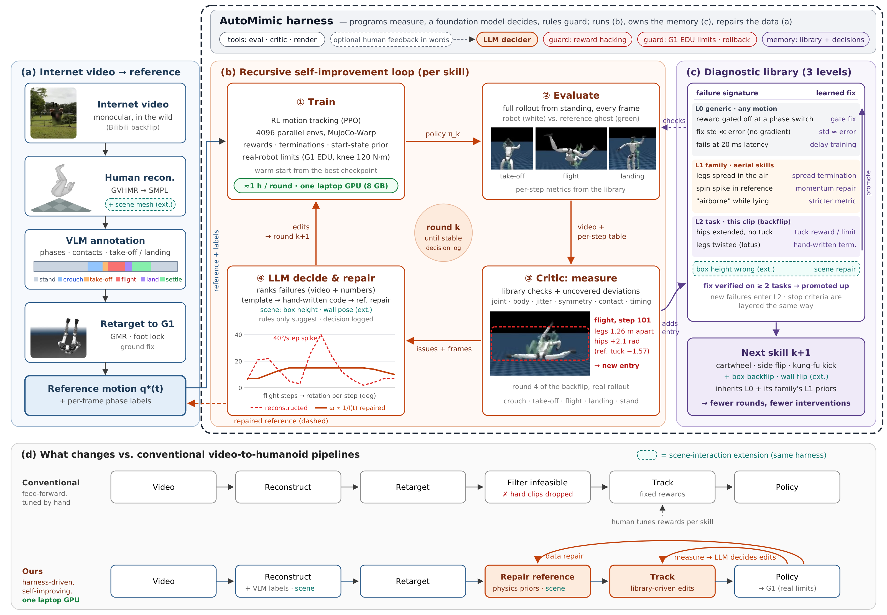
  <br/><sub>总览（论文图 1）。(a) 视频 → 人体重建 → VLM 阶段标注 → retarget；(b) 每个技能的循环：
  训练 → 评测 → critic 量化 → 大模型决策与修复；(c) 三层诊断库（通用 → 动作族 → 任务；验证有效的修复向上晋升，
  结束判定也按同样的三层组织），下一个技能直接继承；(d) 与传统前馈式流程的区别。</sub>
</p>

---

## 目前的结果

### 后空翻：从落地后走开，到干净、安静的完整空翻（大模型决策轮次）

| 轮次 | 决策者 | 旋转 | 平面偏差 | 落地后动作变化 ↓ | 落地后骨盆速度 ↓ | 身体追踪误差 ↓ | decider 发现 / 修复了什么 |
|---|---|---|---|---|---|---|---|
| 8 | 规则 | 344° | 18.5° | 0.30 | – | – | （规则基线，最后一轮） |
| 9 | 大模型 | 358° | 17.0° | 0.41 | 1.20 m/s | 0.120 m | 模板修复的 std 远小于误差 → 没有梯度；髋关节团身晚了 9 步 |
| 10 | 大模型 | 353° | 9.1° | 0.14 | 0.44 m/s | 0.104 m | 规则曾悄悄收紧了追踪课程（通过对比训练日志发现） |
| 11 | 大模型 | 371° | 5.3° | 0.37 | 1.04 m/s | 0.106 m | 分数最高的 checkpoint ≠ 最好的策略 → 由 decider 选择起点 |
| 12 | 大模型 | 368° | 9.1° | **0.05** | **0.14 m/s** | 0.083 m | **根本原因**：平衡类 reward 在 settle→stand 阶段切换处被关掉了 |
| 13 | 大模型 | 367° | 9.3° | 0.04 | 0.05 m/s | 0.073 m | 贴合度课程收紧一级 |
| 14 | 大模型 | 365° | 6.4° | 0.05 | 0.08 m/s | **0.064 m** | 课程收敛 → 转向鲁棒性 |

所有数字都来自从站立开始的完整评测（`rl/flip_auto/analysis/rNN_quant.md`）；每一次决策及其预期指标和回滚条件，
都记录在 [`rl/flip_auto/decisions/`](rl/flip_auto/decisions/)。

### 鲁棒性与 sim-to-sim（第 14 轮策略）

| 场景 | mjlab，256 个环境 | 原生 MuJoCo（CPU），100 次 |
|---|---|---|
| 无扰动 | 100 % | 100 % |
| 训练时的随机化（推力、摩擦 0.3–1.2、质心、编码器偏置、观测噪声） | 100 % | – |
| 脚底摩擦 0.5 / 1.0 | – | 100 % / 100 % |
| PD 刚度 × 0.85 | 100 % | 100 % |
| 控制延迟 20 ms | 70 % | 90 % |
| 控制延迟 40 ms | 0 % | 0 % |

原生 MuJoCo 版本不使用 mjlab 的代码，独立重新实现了观测、动作和策略网络，与 mjlab 的差异在 1e-5 以内；
闭环轨迹的差异被定位到 MuJoCo C 与 MuJoCo-Warp 对"扭矩饱和执行器的阻尼"的积分方式不同
（[`sim2sim/results_flip.md`](sim2sim/results_flip.md)）。第 15 轮加入了随机控制延迟训练（20 ms 成功率提升到 99 %）。

### 侧手翻：第二个技能，需要手撑地，13 轮全程无人工介入

<p align="center">
  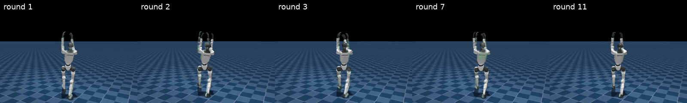
  <br/><sub>第 1、2 轮（侧倒、躺在地上）→ 第 3 轮（第一次直立落地）→ 第 7 轮（分数最高）→ 第 11 轮（全部判定通过）。</sub>
</p>

还是同一套 harness，只是增加了按任务区分的配置（`rl/flip_auto/taskcfg.py`），诊断库里也多了一个*手撑地*动作族。
大部分问题最后都是在**参考动作**里找到的，而不是在 reward 里：

| 轮次 | 旋转 | 落地 | decider 发现 / 修复了什么 |
|---|---|---|---|
| 1 | 231° | 否 | 两个空翻落地类 termination 在参考动作自己的宽站姿落地上就会触发 |
| 2 | 233° | 否 | 关掉这两个 termination；参考动作本身得分就很低的 reward 设为 0；参考动作的双脚踩实地面 |
| 3 | 255° | **是** | 修复参考动作：只用手臂关节让手掌贴地，躯干平滑落地（不再有 2 g 的突降） |
| 4 | 259° | 是 | 机器人用头和前臂撑地翻过去 → 新增"低于参考动作"termination → 改为直臂撑地 |
| 5–8 | 252–264° | 是 | 起始站立时抬脚（新增通用 termination）、站稳不晃、训练被判定的 7.5 s 保持窗口、被推后回到原位 |
| 9–10 | 262–263° | 是 | 训练时随机加入 0–40 ms 控制延迟；落地时手腕抖动 |
| **11** | 291° | 是 | 回滚到第 9 轮 + 手腕修复 → **全部判定通过**（两项落地 / 缓冲阶段的抖动检查附理由豁免） |
| 12–13 | 256–261° | 是 | 对称性 / 安静度修复让落地变差 → 触发回滚规则；保留第 11 轮 |

**第 11 轮策略**（`policies/cartwheel_r11`；到这一轮共用 17.5 GPU 小时，13 轮合计 20.7 GPU 小时）：

| 场景 | mjlab，256 个环境 | 原生 MuJoCo（CPU），100 次 |
|---|---|---|
| 无扰动 | 100 % | 100 % |
| 训练时的随机化 | 99.2 % | – |
| 控制延迟 20 ms | 96.1 % | 100 % |
| 控制延迟 40 ms | 45.3 % | 100 % |
| PD 刚度 × 0.85 | 98.8 % | 100 % |
| 脚底摩擦 0.5 / 1.0 | – | 100 % / 100 % |
| 动作前 / 后各推一下 | – | 100 % / 100 % |

两列用的是同一条成功判定（`rl/eval_flip_robust.py` v2），但 mjlab 的每个场景都在训练随机化（推力、摩擦、质心、
编码器偏置、观测噪声）之上再加该项扰动；原生 MuJoCo 只扰动表中这一项，外加很小的起始抖动。所以 40 ms 一项是 45 % 对 100 %。

决策和分析记录见 [`rl/flip_auto/tasks/cartwheel_2/`](rl/flip_auto/tasks/cartwheel_2/)。

---

## 动图展示

| | |
|---|---|
| 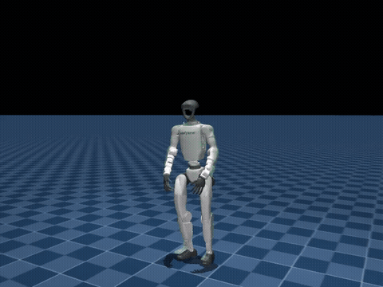<br/><sub>后空翻，第 14 轮（mjlab，高清评测）</sub> | 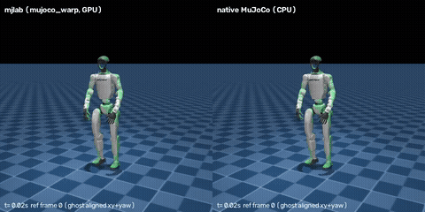<br/><sub>Sim-to-sim：mjlab（左） vs 原生 MuJoCo CPU（右）</sub> |
| 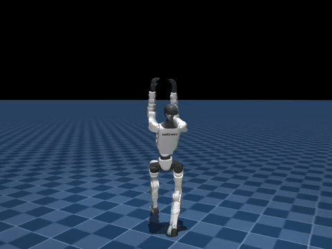<br/><sub>侧手翻，第 11 轮（全部判定通过）</sub> | 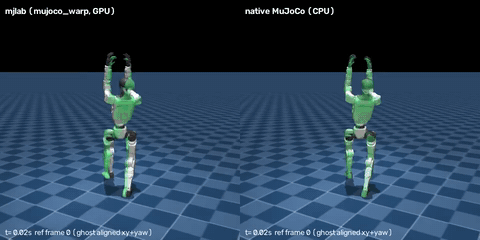<br/><sub>侧手翻 sim-to-sim：mjlab（左） vs 原生 MuJoCo CPU（右）</sub> |
| 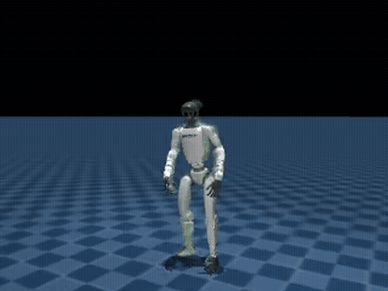<br/><sub>第 1 轮：第一次完成整圈旋转，但没能落地</sub> | 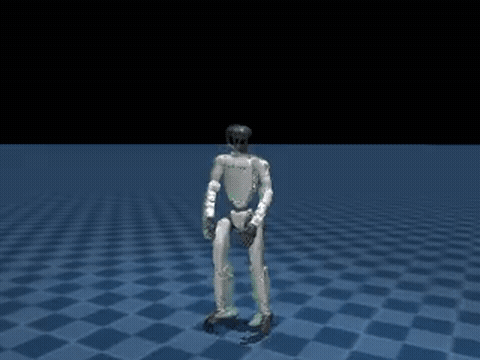<br/><sub>第 4 轮：第一次直立落地</sub> |
| 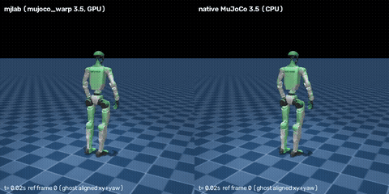<br/><sub>舞蹈专项策略（闪身步）在两个模拟器中</sub> | 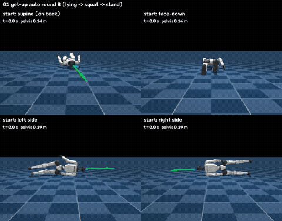<br/><sub>从四种躺姿起身（reward 由 harness 调优）</sub> |

全分辨率视频与动图放在同一目录 [`docs/media/`](docs/media/)。

---

## 一轮迭代是怎么进行的（大模型在环的流程）

```
训练（1500 次 PPO 迭代，4096 个环境）
  → 评测：高清完整动作、逐步数据表、逐帧拼图、鲁棒性（256 个环境 × 5 个场景）
  → 第 1 步  quant_report.py   与上一轮的指标对比、按阶段的偏差、每个已开启修复的有效信号、
                               训练配置审计（对比日志）、按阶段的漂移、鲁棒性、结束判定
  → 第 2 步  大模型分析         看完全部逐帧拼图后，分析原因并排轻重缓急          （analysis/rNN_llm.md）
  → 第 3 步  决策               knob、诊断库修复及其 std、手写代码、起点 checkpoint、
                               预期指标、回滚条件                                  （decisions/rNN.json）
  → 下一轮（缺少第 1、2 步或有拼图没看过的决策，harness 会拒绝执行）
```

基于规则的调整仍然会运行，但只作为报告里的*建议*。`--mode rules` 保留作为消融对照
（第 1–8 轮冻结在 `rl/flip_auto/runs/rules_v1_r01-r08/`）。

## 目录结构

| 路径 | 内容 |
|---|---|
| [`scripts/data/`](scripts/data/) | 视频搜索 / 下载、GVHMR 人体重建、VLM 阶段标注、GMR retarget、参考动作修复（弹道飞行高度、角动量一致的旋转、旋转滞后重定时）、源视频打码 |
| [`rl/train_dance.py`](rl/train_dance.py) | 基于 mjlab / MuJoCo-Warp 的 BeyondMimic 式跟踪训练（按阶段加权的起始状态、真机扭矩限制、控制延迟） |
| [`rl/mimic_generic.py`](rl/mimic_generic.py) | 通用层（L0）reward 模板和真机约束 |
| [`rl/flip_rewards.py`](rl/flip_rewards.py) | 腾空翻转族（L1）与后空翻专用（L2）的技术 reward 和 termination |
| [`rl/flip_auto/`](rl/flip_auto/) | **harness 本体**：`harness.py`、`critic.py`、`quant_report.py`、`library.py`（诊断库）、`stop_criteria.py`、`taskcfg.py`（按任务的路径配置）、`tasks/<任务>/`（每个技能的决策、分析和状态）、参考动作审计、分段测试 |
| [`rl/wm/`](rl/wm/) | 世界模型内核训练器（SuperMimic 式在线 Dyna 循环：学到的动力学 + 短时域解析梯度），用 `harness.py --trainer wm` 选择 |
| [`rl/eval_flip.py`](rl/eval_flip.py)、[`rl/eval_flip_robust.py`](rl/eval_flip_robust.py) | 完整动作评测和 256 环境鲁棒性评测 |
| [`sim2sim/`](sim2sim/) | 原生 MuJoCo（CPU）重新实现、导出的模型（`models/*.mjb`）、等价性与闭环报告 |
| [`policies/`](policies/) | 训练好的策略，附参考动作、阶段标签和评测视频（后空翻 r04/r12/r13/r14、侧手翻 r11、起身、两段舞蹈） |
| [`live/`](live/)、[`vla/`](vla/)、[`artifacts/vla/`](artifacts/vla/) | 实时跟跳 demo：基于骨架的动作识别（模型 + 关键点数据）→ 策略回放 |
| [`paper/`](paper/) | 论文图和图注 |

## 快速上手

```bash
# 环境（WSL2 / Ubuntu 22.04）：见 scripts/setup/ —— unitree_rl_mjlab（mjlab + MuJoCo-Warp）、gvhmr、gmr
# 回放并评测训练好的后空翻
python rl/eval_flip.py --ckpt policies/backflip_r14_fid2/policy.pt \
  --motion policies/backflip_r14_fid2/reference_motion.npz --labels policies/backflip_r14_fid2/labels_50fps.npz \
  --knee-limit 120 --size 960 720
# 鲁棒性评测（每个场景 256 个环境）
python rl/eval_flip_robust.py --ckpt policies/backflip_r14_fid2/policy.pt \
  --motion policies/backflip_r14_fid2/reference_motion.npz --knee-limit 120
# 以大模型模式跑一轮 harness（需要该轮的 decisions/rNN.json）
bash rl/flip_auto/launch_llm.sh <轮次>
```

## 数据说明

源视频是用于研究的第三方网络视频。仓库里只保留实际用到的片段，并对人脸打了马赛克；完整原始视频、SMPL/SMPL-X
人体模型和 AIST++ **不包含**在内（请按各自的许可证从原始来源下载）。姿态模型 `yolov8n-pose.pt` 来自 Ultralytics。

## 当前状态

研究进行中。后空翻（开发用技能）和侧手翻（第二个技能，13 轮，通过 sim-to-sim 测试）已完成。进行中：把 harness 的内核
换成另一种训练方法——用世界模型训练器代替 PPO（目前在跑通阶段，还不是结果），以验证缩短总耗时的是这套循环本身，而不是某个特定的
训练方法。下一步：用冻结的 harness 做更多技能、对比不同基座大模型作为 decider 的能力、多种子评测。代码采用 Apache-2.0 许可证（见 LICENSE）；第三方视频的版权归原作者所有。
